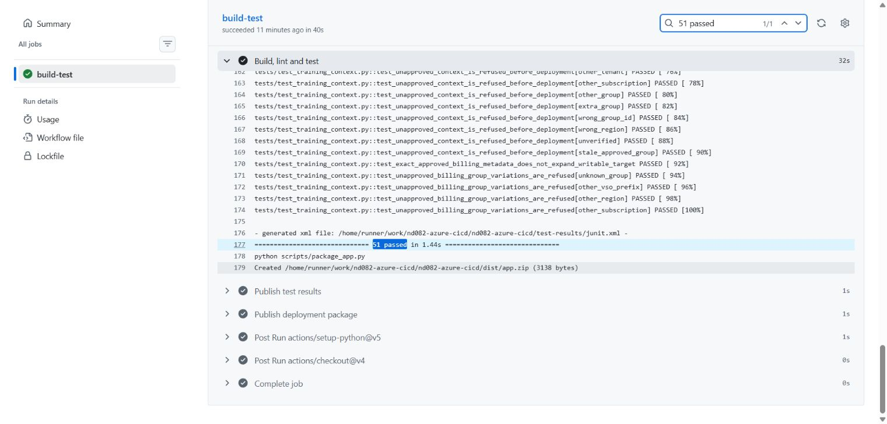
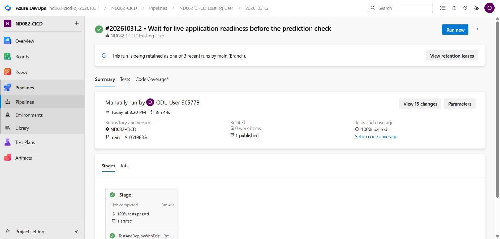
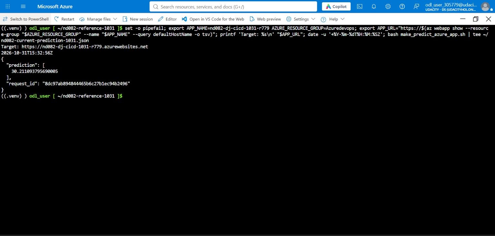
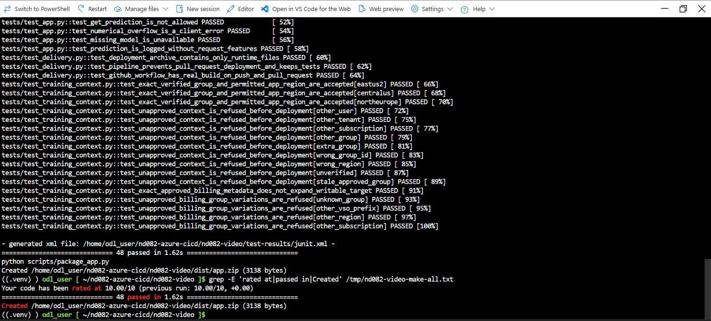
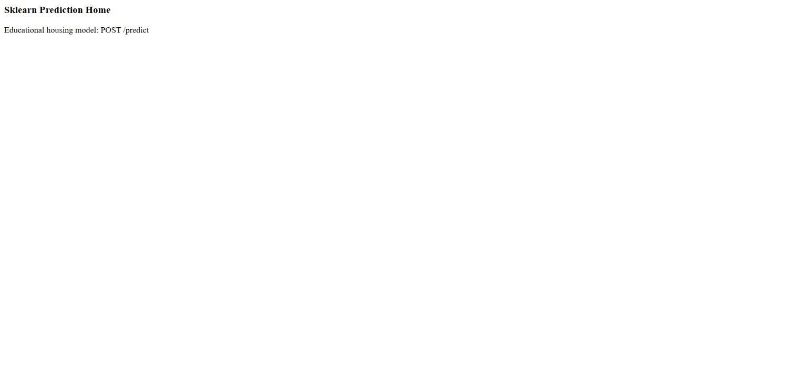
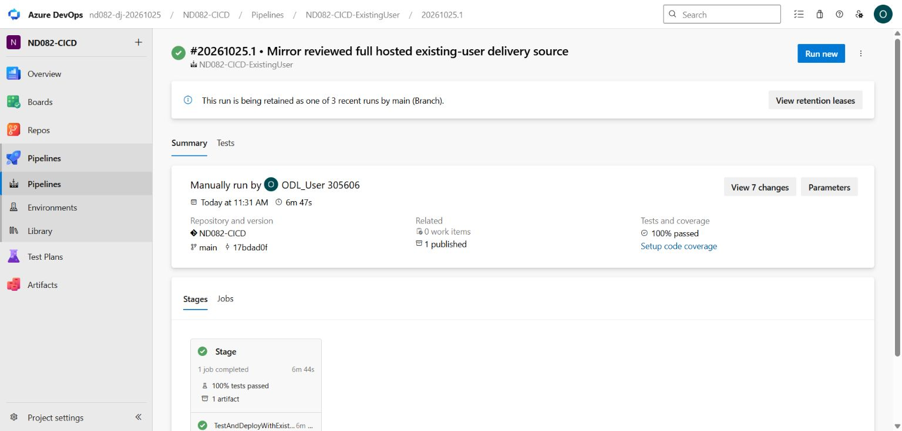
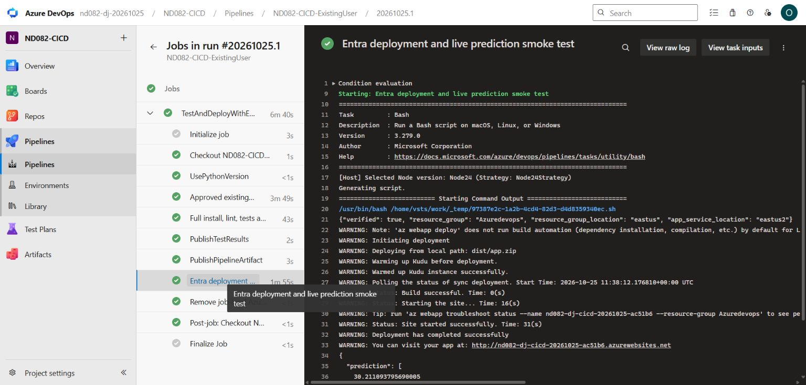
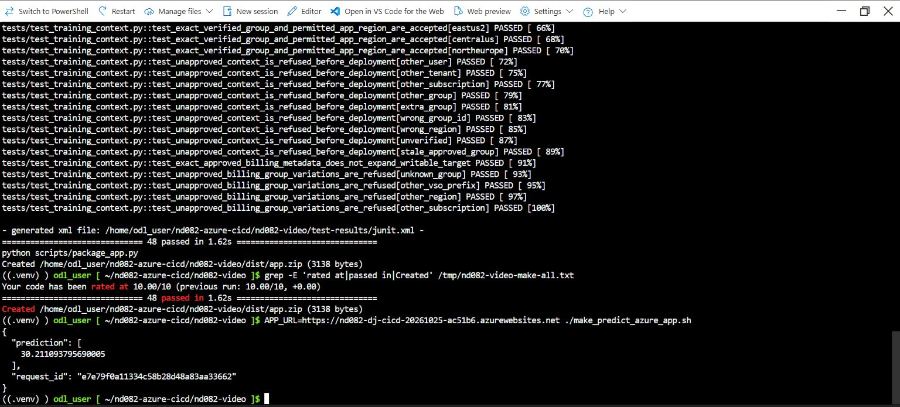
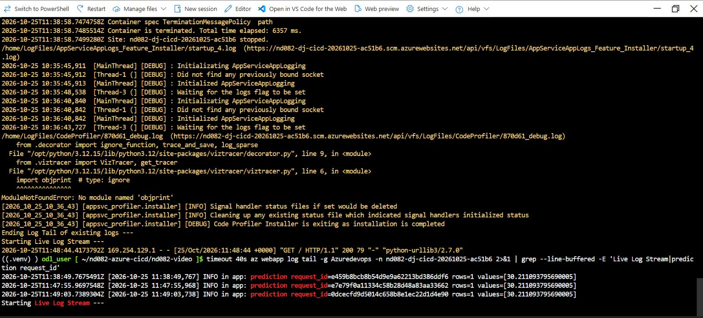

# Building a CI/CD Pipeline

This project delivers a tested Flask housing-prediction API to Linux Azure App Service. GitHub Actions supplies automatic CI. The current Azure Pipelines YAML runs CI without Azure login; explicitly opted-in main-branch, non-PR runs then perform attended Azure deployment and prediction checks.

**Verified baseline on 31 October 2026:** source `0519833c819252ea70c4e6a36d05d25a37264333` passed 51 tests in a fresh Azure Cloud Shell clone and in GitHub Actions. [Azure Pipelines build 2](https://dev.azure.com/nd082-cicd-dj-20261031/ND082-CICD/_build/results?buildId=2) used the earlier Azure Repos mirror and succeeded through tests, artifact publication, deployment, readiness, live JSON prediction and worker-credential cleanup. **The replacement human-recorded 1–5 minute screencast is pending.** The earlier narrated screenshot walkthrough is archival and is not the current video deliverable.

The integration revision is `96d91f458890d39bcef866b97a10e44248e6cb6d`, with GitHub Actions run 13 successful. The approved GitHub App is restricted to this repository and mapped to the existing Azure DevOps organization/project. Direct GitHub-source **definition 2** is configured to `azure-pipelines-existing-user.yml`, with the private context and fixed app variables saved. Its first automatic push-triggered run is **not yet verified**; the earlier mirror build 2 does not prove that new integration.

Source: https://github.com/djessijorge9-ship-it/nd082-azure-cicd

[](https://github.com/djessijorge9-ship-it/nd082-azure-cicd/actions/workflows/ci.yml)

The badge reports the current repository status. [GitHub Actions run 12](https://github.com/djessijorge9-ship-it/nd082-azure-cicd/actions/runs/41214014857) succeeded for source `0519833c819252ea70c4e6a36d05d25a37264333`, including 51 tests. The badge screenshot below is from an earlier checkpoint.




## Architecture and actual delivery path


Commits and pull requests run GitHub lint, tests and packaging. The verified earlier Azure delivery used an explicitly reviewed snapshot in private Azure Repos through definition 1. Direct GitHub-source definition 2 uses the approved repository-scoped GitHub App; its triggered execution is not yet verified. In `azure-pipelines-existing-user.yml`, Microsoft-hosted Ubuntu 24.04 runs `make all`, publishes JUnit and the archive before optional Azure authentication. Authentication and deployment require `allowDeviceCodeBootstrap=true`, a successful CI result, main, and a non-PR run. The existing provided training user signs in through Microsoft's device-login page, then the exact private scope guard must pass.

An opted-in delivery deploys with Microsoft Entra authentication, waits up to 180 seconds for HTTPS `/health` to report `ready`, checks a fresh live prediction, and removes its job-local login cache/private context. Deployment uses `--track-status false` because Linux startup tracking lagged behind the completed Kudu deployment; readiness and prediction remain required. SCM and FTP basic publishing authentication remain disabled. No ARM service connection, service principal, PAT or extra agent VM is used by this delivery path.

Azure delivery remains **attended**, with manual authentication for each opted-in fresh worker. The revised YAML permits CI when that opt-in is false; it does not establish unattended Azure deployment. The verified mirror delivery is build 2 in organization `nd082-cicd-dj-20261031`. In the historical `nd082-dj-20261025` organization, the service-connection alternative's definition 1 was disabled, and [probe run 2](https://dev.azure.com/nd082-dj-20261025/ND082-CICD/_build/results?buildId=2) proved CI capacity only. Those older IDs are separate from the verified 31 October mirror build 2. See [private-input and authentication details](docs/EXISTING_USER_PIPELINE.md).

Historical run 3 on 25 October used Azure Repos commit `17bdad0f615507a8d0e68e1585df042dd7918ba9`, corresponding to public source `3fc837af903e12ce98f527539a11848cfe37ae1a`. All job tasks succeeded. The [Test Run 3 results](https://dev.azure.com/nd082-dj-20261025/ND082-CICD/_TestManagement/Runs?runId=3&_a=runCharts) and individual-case API readback confirm 48/48 Passed and one `app-source` PipelineArtifact. The earlier Build Summary display lagged behind the APIs; the retained screenshot shows one published artifact and 100% passed. The [independent test/artifact readback](evidence/azure-pipelines-run3-summary.json) preserves that historical observation, alongside the [successful historical GitHub run](https://github.com/djessijorge9-ship-it/nd082-azure-cicd/actions/runs/40189164258).

## Project plan

The [Excel project plan](https://github.com/djessijorge9-ship-it/nd082-azure-cicd/blob/main/docs/Project-Plan.xlsx) uses the supplied `Project Management Plan` template for its first tab, with current 31 October weekly deliverables, per-task estimates, quarterly/yearly goals and pending work. Two dated tabs preserve the original 25 October plan and roadmap. A [local copy](docs/Project-Plan.xlsx) and the [historical 25 October CSV](docs/PROJECT_PLAN.csv) are included. The existing original/revised estimates remain 6 and 7 hours; these are estimates, not recorded labour times. Original scheduled weeks are retained rather than relabeled as actual completion dates.

The [publicly readable Trello board](https://trello.com/b/9wbc68TD/nd082-azure-ci-cd) has To Do, In Progress and Done lists. Its retained 25 October snapshot marks T1–T8 Done, including the earlier narrated walkthrough/handoff. That board snapshot and the CSV are historical; the workbook's first tab explicitly keeps the replacement human recording pending and direct-source integration in progress. Only board members can edit the board.


## Run locally

Use Python 3.12 in a virtual environment. From the repository root on Bash:

```bash
python3 -m venv .venv
source .venv/bin/activate
make all
make test
make run
```

On Windows activate `.venv\Scripts\Activate.ps1`. Without Make, run `python -m pip install -r requirements-dev.txt`, `python -m pylint app.py scripts tests`, `python -m pytest -v`, and `python scripts/package_app.py`. In another terminal, run `python scripts/predict.py http://127.0.0.1:5000`.

The sample predicts approximately `30.211093795690005`. Responses contain request IDs. `GET /health` checks model readiness. The API rejects missing/extra features, invalid JSON, non-finite values, mismatched batches, requests over 16 KiB and batches over 100 rows. Prediction logs contain values and request IDs without all input features.

### Model contract

The model uses `CHAS, RM, TAX, PTRATIO, B, LSTAT` in that order. The starter selected a linear model trained on raw features, so this service does not fit a scaler on inference data. The original per-request scaler reduced single rows to zero vectors and made predictions constant; this correction changes the obsolete starter example output.

The original serialized model used scikit-learn 1.1.3 while the current starter pins 1.5.1. `scripts/train_model.py` reproduces the official notebook with the included CSV, six features, seed 7, and scikit-learn 1.5.1. The split is 404 training/102 test rows; actual held-out MSE is `39.95883743552935`. Versions, feature order, coefficients and data/model hashes are in `Housing_price_model/metadata.json`. This demonstrates reproducibility, not production model quality.

The historical Boston dataset contains a racially constructed feature. It is retained only to reproduce this supplied educational exercise and is unsuitable for real housing decisions. A new application should use an appropriate dataset and versioned preprocessing.

## Cloud Shell and application evidence

### Current verification: 31 October 2026

The fresh Cloud Shell clone at baseline `0519833c819252ea70c4e6a36d05d25a37264333` passed 51 tests in 1.71 seconds. The earlier full attended [Azure Pipelines mirror build 2](https://dev.azure.com/nd082-cicd-dj-20261031/ND082-CICD/_build/results?buildId=2) ran from 15:22:56 to 15:26:41 UTC; all tasks succeeded. Its prediction smoke check returned `30.211093795690005` with request ID `a194c0ed5bf14a5f8b69543dbbcaaaa9`. These results precede integration revision `96d91f4`.




A fresh Cloud Shell POST at 15:32:56 UTC returned the same prediction with new request ID `8dc97ab894844465b6c27b1ec94b2496`. The current F1 app is temporarily active for the bounded recording session. Remove only its exact owned app and sole-use plan after the required recording evidence is saved.



The current App Service screenshot shows Running, Healthy runtime status, Linux Python 3.12 and the F1 plan. A further fresh request at 16:11:01 UTC returned prediction `30.211093795690005`, request ID `9af7c43087a842b093df42e002c9bf0c`; the live application stream contains that same full ID and value.


### Historical verification: 25 October 2026

Actual Cloud Shell clones of the earlier public source completed `make all` with 48 passing tests, pylint 10/10, a 3,138-byte runtime archive and exit 0. The first retained build used `bf886ac3b409a93a4ad442b7688dcb5eb22385ac`; the later capture repeated it at the historical hosted-delivery source snapshot. These were ephemeral Bash sessions without a storage account. A visible console excerpt is retained; the normal full-log download failed and is not presented as available.




The historical training App Service passed real health, single-row, batch and invalid-schema HTTP checks. Its first-row prediction remains unchanged in a batch, while increasing RM changes the second result. See [actual HTTP responses](evidence/azure-prediction.json) and [matching Azure request-ID log lines](evidence/azure-prediction-log.txt). After all actual screenshots/video were saved, the exact owned app and its sole-use F1 plan were removed at 12:41:57 UTC on 25 October 2026. The former endpoint is no longer available. [Cleanup readback](evidence/azure-cleanup.json) confirms both targets absent, other resource inventory unchanged, and training groups/billing metadata preserved.



The actual full Azure delivery and deployment logs are retained here:





A fresh request after delivery returned request ID `e7e79f0a11334c58b28d48a83aa33662` and prediction `30.211093795690005`. The genuine app log contains the same ID and value. The request ID and value are transcribed from these screenshots.





The [cloud runbook](docs/CLOUD_RUNBOOK.md) records reproducible steps. `commands.sh` includes the required `az webapp up -n "$APP_NAME"` operation with basic publishing auth disabled. The current writable group is exactly `Azuredevops`, metadata region `southcentralus`; the historical 25 October assignment used `eastus`. The separately approved App Service target remains `eastus2`. An exact service-managed DevOps billing group is read-only baseline metadata, never a deployment or cleanup target. Keep private scope files and tokens outside source/evidence archives.

## Validation and retained evidence

| Evidence | Observed result |
| --- | --- |
| Cloud Shell clone and tests | 31 October baseline 0519833: 51 passed in 1.71 seconds; historical 48-test/lint evidence retained separately |
| GitHub Actions and badge | Run 13 succeeded for integration revision 96d91f4; retained run 12 screenshot shows baseline 0519833 |
| App Service and predictions | Current F1 app view and matching fresh JSON/live stream at 16:11:01 UTC retained; 25 October app/plan cleanup remains historical |
| Azure Pipelines full delivery | Earlier mirror build 2 succeeded: tests, JUnit, artifact, Entra deployment, readiness, prediction and worker-credential removal |
| Direct GitHub-source pipeline | Definition 2 configured with approved repository-scoped App, correct YAML and saved variables; automatic push-triggered execution not yet verified |
| Historical cases and artifact | 25 October Test Run 3/build 3: 48 Passed cases and one app-source PipelineArtifact, verified through official APIs |
| Plan and Trello | Supplied template completed with current status and dated original history; historical board/CSV retained; 6/7 hour estimates unchanged |
| Human-recorded screencast, 1–5 minutes | Pending: readable 1080p+, 16:9, clear audio, full login-to-prediction workflow and streamed application logs |

`evidence/status.json` retains the 25 October evidence snapshot; the current verification is dated above. No local test is relabeled as a remote build, and a prepared YAML file alone is not treated as executed delivery. Test counts are tied to their source snapshots.

## Demonstration and enhancements

The replacement human-recorded screencast is pending. It must be 1–5 minutes, at least 1080p with 16:9 aspect ratio, readable text and clear audio. Show the operator's actual workflow from Azure Cloud Shell login through CI, the successful GitHub Actions build, Azure deployment, a fresh JSON prediction and streamed logs from the deployed application. Publish its YouTube link only after that recording exists and has been checked.

The [earlier Unlisted screenshot walkthrough](https://youtu.be/KyiWE4R-WMA) is **archival and superseded as the current video deliverable**. It is a 184.30-second, 1920×1080/30fps narrated assembly of historical screenshots, rather than the required human screencast.

Future proposals are a suitable replacement dataset, drift/model-version checks, reviewed dependency updates, approved staging/rollback, and availability/latency monitoring. The 2027 roadmap is a proposal, not authorization for ongoing Azure spend.

The dated Cloud Shell, CI/CD, application, prediction/log and board captures distinguish current execution from historical evidence. Original captures are preserved without editing or upscaling.

## Sources

- [Official Udacity starter](https://github.com/udacity/nd082-Azure-Cloud-DevOps-Starter-Code), commit `a239a572c6d6153317f29841973b49a9f78a84f9`, directory `C2-AgileDevelopmentwithAzure/project/starter_files/flask-sklearn`. Original source is preserved separately; its license is included as `LICENSE.udacity.md`.
- [Azure Pipelines Python App Service tutorial](https://learn.microsoft.com/en-us/azure/devops/pipelines/ecosystems/python-webapp?view=azure-devops) and [Azure App Service Python guide](https://learn.microsoft.com/en-us/azure/app-service/quickstart-python), checked 25 October 2026.
- Current classroom rubric: ND082 version 3.0.16, Building a CI/CD Pipeline, checked 25 October 2026.
