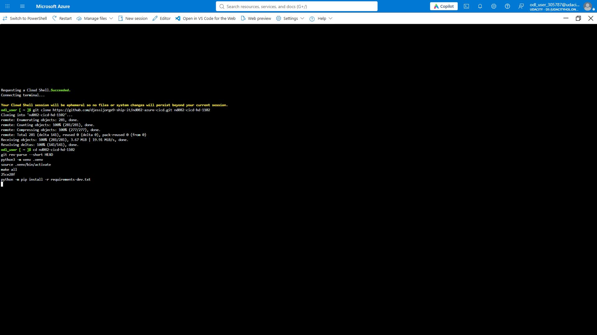
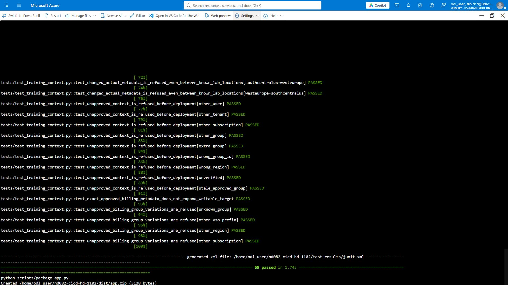
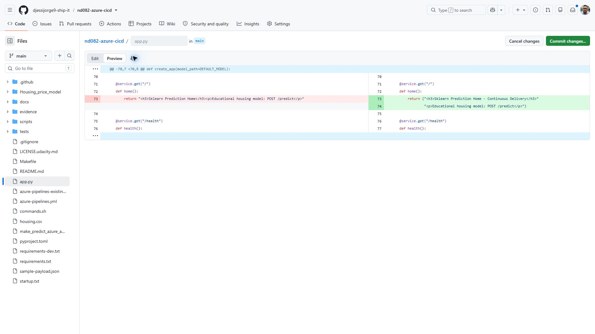
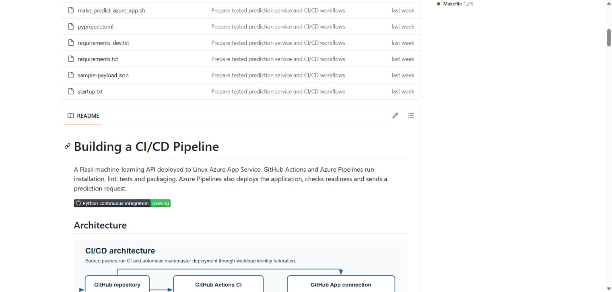
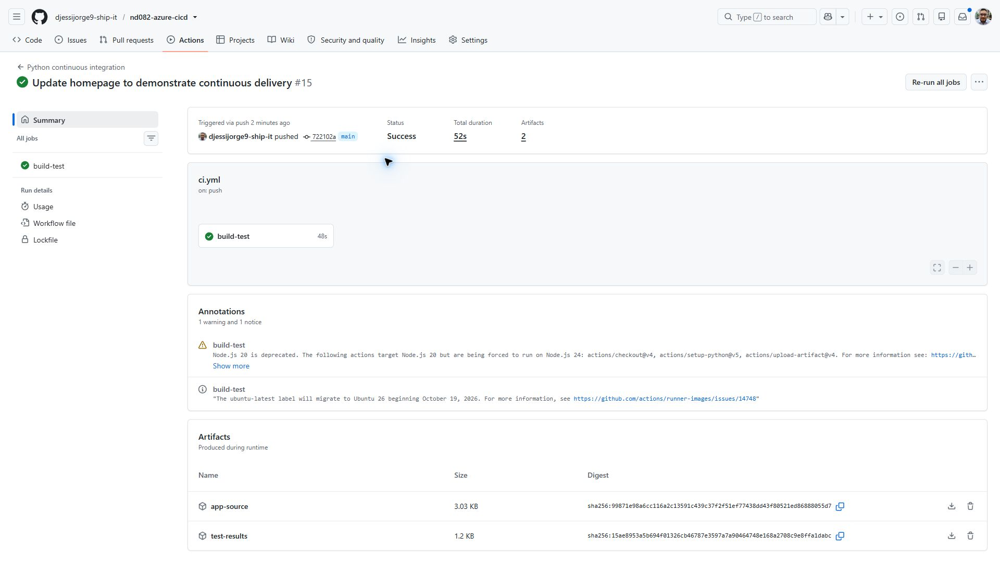
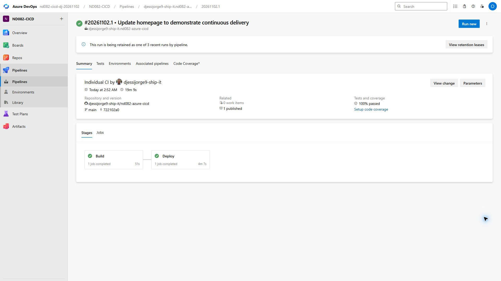
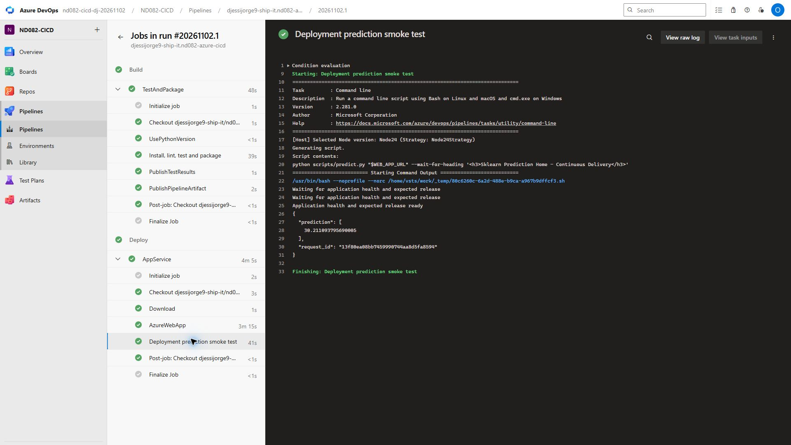
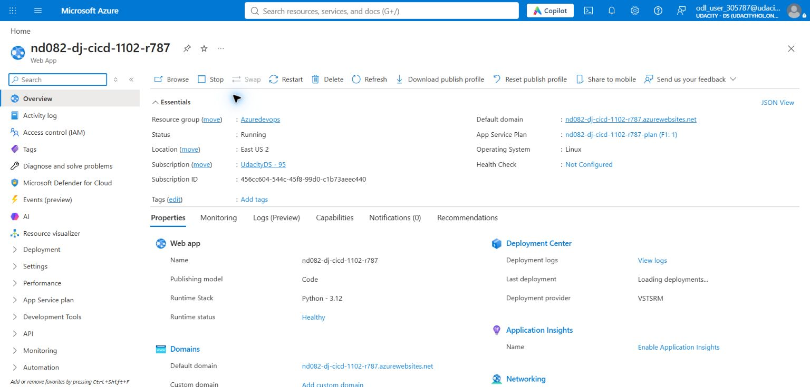
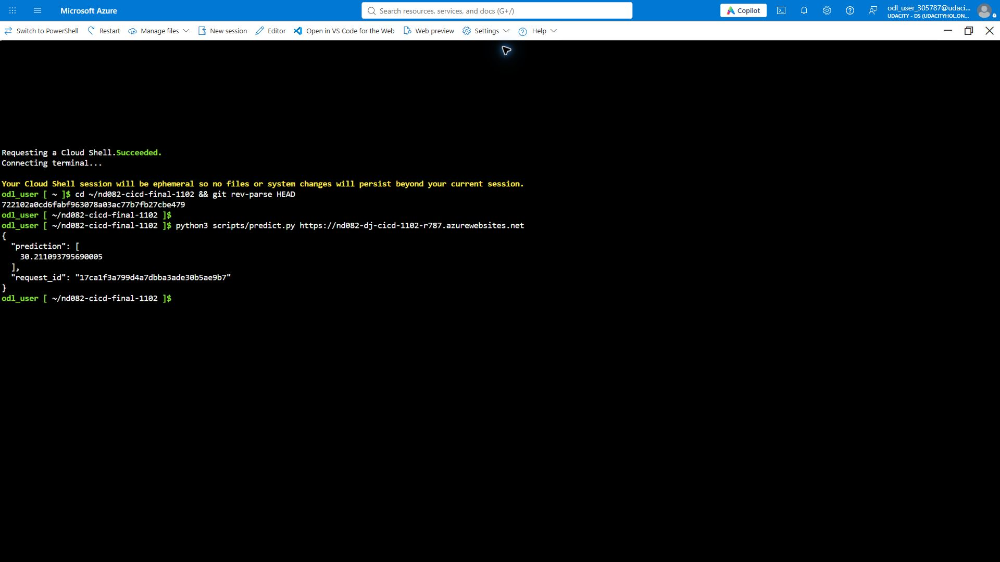
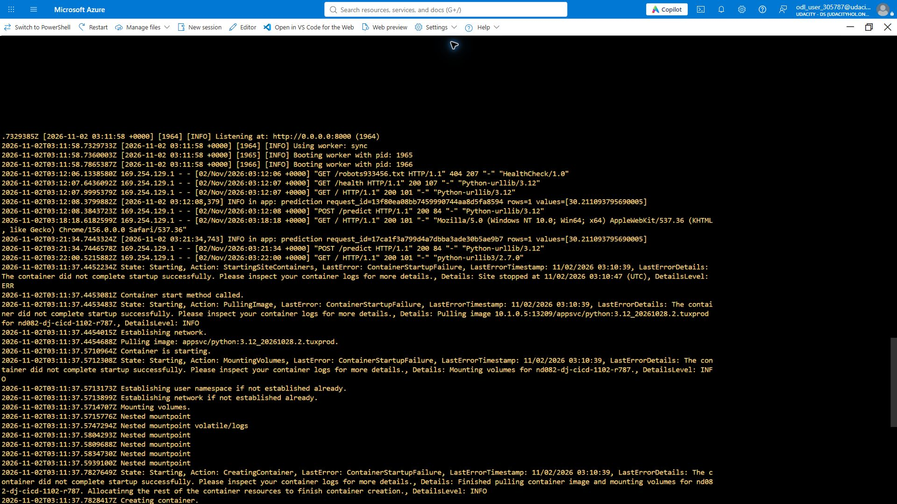

# Building a CI/CD Pipeline

A Flask machine-learning API deployed to Linux Azure App Service. GitHub Actions and Azure Pipelines run installation, lint, tests and packaging. Azure Pipelines also deploys the application, checks readiness and sends a prediction request.


[GitHub Actions workflow](https://github.com/djessijorge9-ship-it/nd082-azure-cicd/actions/workflows/ci.yml) · [Live status badge](https://github.com/djessijorge9-ship-it/nd082-azure-cicd/actions/workflows/ci.yml/badge.svg?branch=main)

[Read this README on GitHub](https://github.com/djessijorge9-ship-it/nd082-azure-cicd/blob/main/README.md)

## Required evidence

The screenshots are embedded in the sections below. These direct GitHub links also open the full-size evidence.

| Requirement | Screenshot |
| --- | --- |
| GitHub Actions passing status badge | [Rendered badge screenshot](https://github.com/djessijorge9-ship-it/nd082-azure-cicd/blob/c6bc33ef2bae24256011181b7b0475f44df953e4/evidence/github-actions-badge.jpg) |
| Repository cloned in Azure Cloud Shell | [Cloud Shell clone](https://github.com/djessijorge9-ship-it/nd082-azure-cicd/blob/c6bc33ef2bae24256011181b7b0475f44df953e4/evidence/cloudshell-clone.jpg) |
| Passing tests after `make all` | [Cloud Shell test results](https://github.com/djessijorge9-ship-it/nd082-azure-cicd/blob/c6bc33ef2bae24256011181b7b0475f44df953e4/evidence/cloudshell-tests.jpg) |
| Application test run in Azure Cloud Shell | [Successful JSON prediction](https://github.com/djessijorge9-ship-it/nd082-azure-cicd/blob/c6bc33ef2bae24256011181b7b0475f44df953e4/evidence/cloudshell-prediction.jpg) |
| Working GitHub Actions build | [GitHub Actions run 15](https://github.com/djessijorge9-ship-it/nd082-azure-cicd/blob/c6bc33ef2bae24256011181b7b0475f44df953e4/evidence/github-actions-success.jpg) |
| Successful Azure Pipelines run | [Build and Deploy succeeded](https://github.com/djessijorge9-ship-it/nd082-azure-cicd/blob/c6bc33ef2bae24256011181b7b0475f44df953e4/evidence/azure-pipeline-success.jpg) |
| Deployed Azure App Service | [App Service overview](https://github.com/djessijorge9-ship-it/nd082-azure-cicd/blob/c6bc33ef2bae24256011181b7b0475f44df953e4/evidence/app-service-overview.jpg) |
| Successful prediction from the deployed app | [Cloud Shell prediction](https://github.com/djessijorge9-ship-it/nd082-azure-cicd/blob/c6bc33ef2bae24256011181b7b0475f44df953e4/evidence/cloudshell-prediction.jpg) |
| Streamed application logs | [Matching prediction log](https://github.com/djessijorge9-ship-it/nd082-azure-cicd/blob/c6bc33ef2bae24256011181b7b0475f44df953e4/evidence/prediction-logstream.jpg) |

## Architecture


[Full-size image: CI/CD architecture](https://github.com/djessijorge9-ship-it/nd082-azure-cicd/blob/c6bc33ef2bae24256011181b7b0475f44df953e4/docs/architecture.svg)

`azure-pipelines.yml` defines the delivery workflow using a repository-scoped GitHub App connection. It runs installation, lint, tests and packaging on Microsoft-hosted Ubuntu 24.04. The Build stage publishes JUnit results and `app-source`; successful main/master pushes continue automatically to Deploy. Pull requests run Build.

Deploy uses the verified `nd082-app-wif` service connection and user-assigned managed identity to authenticate through workload identity federation. `AzureWebApp@1` updates the existing app in `Azuredevops`. The smoke test requires HTTPS `/health` to return `ready` and the complete homepage heading `<h3>Sklearn Prediction Home - Continuous Delivery</h3>` before sending a prediction. See [pipeline configuration](docs/EXISTING_USER_PIPELINE.md).

The classroom app demonstrated on 2 November 2026 was [nd082-dj-cicd-1102-r787](https://nd082-dj-cicd-1102-r787.azurewebsites.net), running Linux Python 3.12 on F1 in East US 2. In that demonstration, HTTPS was enabled; SCM and FTP basic publishing authentication were disabled. The deployment identity had Website Contributor permission on this app.

## Project plan

- [Trello board](https://trello.com/b/9wbc68TD/nd082-azure-ci-cd): project tasks organized as To Do, In Progress and Done.
- [Project spreadsheet](docs/Project-Plan.xlsx): the supplied planning template, original/revised task estimates, weekly deliverables and quarterly/yearly goals. The original and revised estimates total 6 and 7 hours.


[Full-size image: Project board](https://github.com/djessijorge9-ship-it/nd082-azure-cicd/blob/c6bc33ef2bae24256011181b7b0475f44df953e4/evidence/trello-board-current.jpg)

## Verified workflow - 2 November 2026

The original homepage displayed `Sklearn Prediction Home`. The [application change](https://github.com/djessijorge9-ship-it/nd082-azure-cicd/commit/722102a0cd6fabf963078a03ac77b7fb27cbe479) updated only `app.py` to display `Sklearn Prediction Home - Continuous Delivery`. Its push automatically triggered both CI and delivery for commit `722102a0cd6fabf963078a03ac77b7fb27cbe479`.

| Check | Result |
| --- | --- |
| Azure Cloud Shell before the change | Repository cloned; `make all` passed 59 tests in 1.74 seconds and created the original 3,138-byte package. |
| [GitHub Actions 15](https://github.com/djessijorge9-ship-it/nd082-azure-cicd/actions/runs/41380035852) | Push-triggered success; 59 tests in 1.58 seconds; changed application package 3,158 bytes. |
| [Azure Pipelines 20261102.1](https://dev.azure.com/nd082-cicd-dj-20261102/ND082-CICD/_build/results?buildId=1) | Individual CI for the same commit; Build and Deploy succeeded, with 100% of tests passed. |
| Live application | Changed homepage visible at `nd082-dj-cicd-1102-r787.azurewebsites.net`. |
| Fresh prediction | `30.211093795690005`; request ID `17ca1f3a799d4a7dbba3ade30b5ae9b7`. The streamed log records one row and HTTP 200 at 03:21:34 UTC. |

### Azure Cloud Shell repository clone

The repository was cloned in the provided Azure Cloud Shell, then built and tested with `make all`.


[Full-size image: Repository cloned in Azure Cloud Shell](https://github.com/djessijorge9-ship-it/nd082-azure-cicd/blob/c6bc33ef2bae24256011181b7b0475f44df953e4/evidence/cloudshell-clone.jpg)

### Azure Cloud Shell make all test results

The command and its completed output are shown separately from the same Cloud Shell session.



[Full-size image: Azure Cloud Shell make all command](https://github.com/djessijorge9-ship-it/nd082-azure-cicd/blob/c6bc33ef2bae24256011181b7b0475f44df953e4/evidence/cloudshell-make-all-command.jpg)



[Full-size image: Cloud Shell make all: 59 tests passed](https://github.com/djessijorge9-ship-it/nd082-azure-cicd/blob/c6bc33ef2bae24256011181b7b0475f44df953e4/evidence/cloudshell-tests.jpg)

### Source change and automatic delivery

The live homepage before the change:


[Full-size image: Original live homepage](https://github.com/djessijorge9-ship-it/nd082-azure-cicd/blob/c6bc33ef2bae24256011181b7b0475f44df953e4/evidence/homepage-before.jpg)

The application diff changed the homepage heading:



[Full-size image: Homepage source change](https://github.com/djessijorge9-ship-it/nd082-azure-cicd/blob/c6bc33ef2bae24256011181b7b0475f44df953e4/evidence/homepage-change.jpg)

GitHub Actions completed for the resulting push:



[Full-size image: GitHub Actions passing status badge](https://github.com/djessijorge9-ship-it/nd082-azure-cicd/blob/c6bc33ef2bae24256011181b7b0475f44df953e4/evidence/github-actions-badge.jpg)



[Full-size image: Successful push-triggered GitHub Actions run 15](https://github.com/djessijorge9-ship-it/nd082-azure-cicd/blob/c6bc33ef2bae24256011181b7b0475f44df953e4/evidence/github-actions-success.jpg)

### Azure Pipelines successful run

Azure Pipelines built and deployed the same commit automatically:



[Full-size image: Azure Pipelines 20261102.1 Build and Deploy succeeded](https://github.com/djessijorge9-ship-it/nd082-azure-cicd/blob/c6bc33ef2bae24256011181b7b0475f44df953e4/evidence/azure-pipeline-success.jpg)

The deployment smoke test waited for the complete new heading and model readiness before requesting a prediction:



[Full-size image: Successful release readiness and prediction smoke test](https://github.com/djessijorge9-ship-it/nd082-azure-cicd/blob/c6bc33ef2bae24256011181b7b0475f44df953e4/evidence/azure-release-smoke.jpg)

### Azure App Service deployment

The Azure App Service overview shows `nd082-dj-cicd-1102-r787` running on Linux Python 3.12 with a healthy runtime and its F1 plan in `Azuredevops`:



[Full-size image: Azure App Service overview: running application and healthy Python runtime](https://github.com/djessijorge9-ship-it/nd082-azure-cicd/blob/c6bc33ef2bae24256011181b7b0475f44df953e4/evidence/app-service-overview.jpg)

The updated Azure App Service homepage after delivery:


[Full-size image: Changed live App Service homepage](https://github.com/djessijorge9-ship-it/nd082-azure-cicd/blob/c6bc33ef2bae24256011181b7b0475f44df953e4/evidence/homepage-after.jpg)

### Application test run in Azure Cloud Shell

A separate fresh prediction from Cloud Shell:



[Full-size image: Fresh JSON prediction from the deployed application](https://github.com/djessijorge9-ship-it/nd082-azure-cicd/blob/c6bc33ef2bae24256011181b7b0475f44df953e4/evidence/cloudshell-prediction.jpg)

The matching streamed log contains `request_id=17ca1f3a799d4a7dbba3ade30b5ae9b7`, `rows=1`, the same prediction and the successful `POST /predict` response:



[Full-size image: Matching fresh prediction and HTTP 200 in the live log stream](https://github.com/djessijorge9-ship-it/nd082-azure-cicd/blob/c6bc33ef2bae24256011181b7b0475f44df953e4/evidence/prediction-logstream.jpg)

## Run locally

Use Python 3.12. From the repository root:

```bash
python3 -m venv .venv
source .venv/bin/activate
make all
make run
```

In another terminal:

```bash
source .venv/bin/activate
python scripts/predict.py http://127.0.0.1:5000
```

On Windows, activate `.venv\Scripts\Activate.ps1`. Without Make, run `python -m pip install -r requirements-dev.txt`, `python -m pylint app.py scripts tests`, `python -m pytest -v` and `python scripts/package_app.py`. Start the local server with `python -m flask --app app run --host 127.0.0.1 --port 5000`, then send the prediction from another terminal.

`make all` installs dependencies, lints the project, runs tests and creates `dist/app.zip`. `make test` writes JUnit results to `test-results/junit.xml`.

## Deploy and inspect

Cloud commands require Azure CLI authentication to the assigned classroom subscription and the private scope configuration named by `AZURE_CONTEXT_FILE`. The application uses the existing `Azuredevops` group and a Linux Python 3.12 F1 plan in `eastus2`.

```bash
export AZURE_CONTEXT_FILE="$HOME/project02-approved-context-1102-v2.json"
export AZURE_RESOURCE_GROUP=Azuredevops
export AZURE_LOCATION=eastus2
export APP_NAME=nd082-dj-cicd-1102-r787
python3 scripts/verify_training_context.py
bash commands.sh
export APP_URL="https://$(az webapp show --resource-group "$AZURE_RESOURCE_GROUP" --name "$APP_NAME" --query defaultHostName -o tsv)"
bash make_predict_azure_app.sh
```

`commands.sh` includes `az webapp up -n "$APP_NAME"`, sets HTTPS, configures build/startup settings and enables container logging. The [cloud runbook](docs/CLOUD_RUNBOOK.md) contains the full execution steps.

Stream the application logs in one Cloud Shell session and send a prediction from another:

```bash
az webapp log tail --resource-group "$AZURE_RESOURCE_GROUP" --name "$APP_NAME"
```

Compare the response's `request_id` and prediction with the matching log entry.

## Workflow demonstration

[Workflow demonstration](https://youtu.be/h-94cK-0wSU)

| Time | Step |
| --- | --- |
| 0:00 | Azure Cloud Shell checkout and continuous integration |
| 0:44 | Homepage source change, commit and push |
| 1:09 | Push-triggered GitHub Actions build |
| 1:35 | Automatic Azure build and deployment |
| 2:03 | Updated live App Service homepage |
| 2:15 | Fresh JSON prediction from Cloud Shell |
| 2:31 | Matching streamed prediction log |

## Model and API

The model takes `CHAS, RM, TAX, PTRATIO, B, LSTAT` in that order and uses raw feature values. `scripts/train_model.py` reproduces the supplied notebook with scikit-learn 1.5.1 and seed 7. The split contains 404 training and 102 test rows; held-out MSE is `39.95883743552935`. Model versions, features and hashes are in `Housing_price_model/metadata.json`.

`GET /health` reports model readiness. `POST /predict` returns predictions and a request ID. The API validates feature names, JSON structure, finite numeric values, batch sizes up to 100 and requests up to 16 KiB.

The supplied Boston housing dataset is used for this educational deployment example.

## Improvements

Future improvements include a suitable replacement dataset, versioned preprocessing, dependency updates, staging/rollback and availability/latency monitoring.

## Sources

- [Official Udacity starter](https://github.com/udacity/nd082-Azure-Cloud-DevOps-Starter-Code), commit `a239a572c6d6153317f29841973b49a9f78a84f9`, `C2-AgileDevelopmentwithAzure/project/starter_files/flask-sklearn`. The [starter license](LICENSE.udacity.md) is included.
- [Azure Pipelines Python App Service tutorial](https://learn.microsoft.com/en-us/azure/devops/pipelines/ecosystems/python-webapp?view=azure-devops).
- [Azure App Service Python guide](https://learn.microsoft.com/en-us/azure/app-service/quickstart-python).
