# Building a CI/CD Pipeline

A Flask machine-learning API deployed to Linux Azure App Service. GitHub Actions and Azure Pipelines run installation, lint, tests and packaging. Azure Pipelines also deploys the application, checks readiness and sends a prediction request.

[](https://github.com/djessijorge9-ship-it/nd082-azure-cicd/actions/workflows/ci.yml)

## Architecture

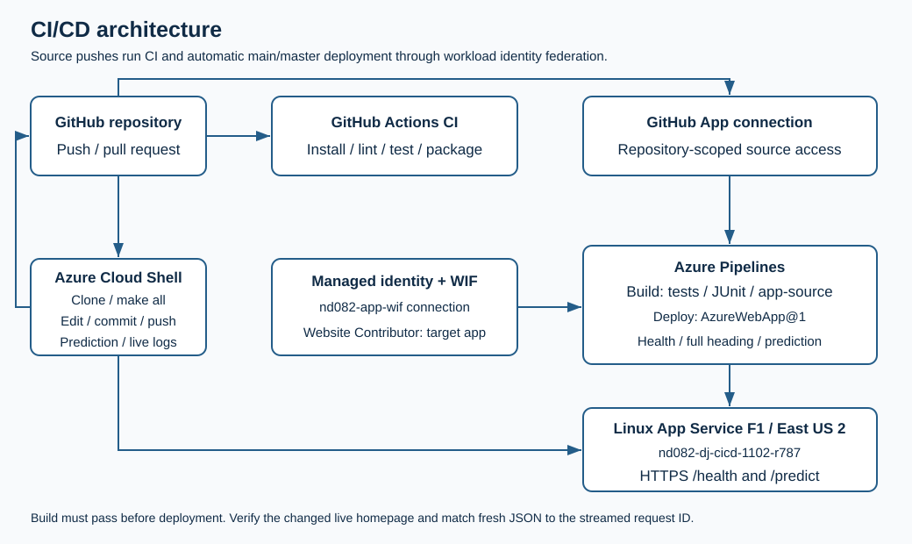

The GitHub App connects the repository directly to Azure Pipelines. Source changes run CI on Microsoft-hosted Ubuntu 24.04. The pipeline publishes JUnit results and `app-source`, then runs deployment when `allowDeviceCodeBootstrap=true` on a successful main-branch, non-PR run. Deployment uses Microsoft Entra device authentication and validates the classroom identity, subscription, resource group and app name.

The deployment script updates the existing App Service, requires disabled SCM/FTP basic authentication, waits for HTTPS `/health` to return `ready`, and checks `/predict`. Temporary worker authentication state is removed when the job finishes. See [pipeline configuration](docs/EXISTING_USER_PIPELINE.md).

## Project plan

- [Trello board](https://trello.com/b/9wbc68TD/nd082-azure-ci-cd): project tasks organized as To Do, In Progress and Done.
- [Project spreadsheet](docs/Project-Plan.xlsx): the supplied planning template, original/revised task estimates, weekly deliverables and quarterly/yearly goals. The original and revised estimates total 6 and 7 hours.

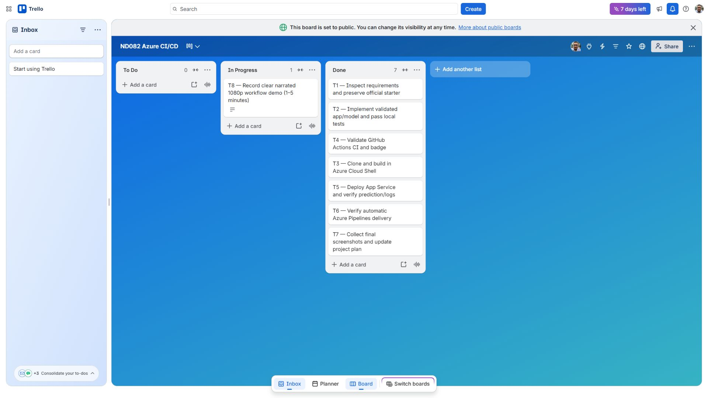

## Run locally

Use Python 3.12. From the repository root:

```bash
python3 -m venv .venv
source .venv/bin/activate
make all
make run
```

In another terminal:

```bash
source .venv/bin/activate
python scripts/predict.py http://127.0.0.1:5000
```

On Windows, activate `.venv\Scripts\Activate.ps1`. Without Make, run `python -m pip install -r requirements-dev.txt`, `python -m pylint app.py scripts tests`, `python -m pytest -v` and `python scripts/package_app.py`.

`make all` installs dependencies, lints the project, runs tests and creates `dist/app.zip`. `make test` writes JUnit results to `test-results/junit.xml`.

## Deploy and inspect

Cloud commands require Azure CLI authentication to the assigned classroom subscription and the private scope configuration named by `AZURE_CONTEXT_FILE`. The application uses the existing `Azuredevops` group and a Linux Python 3.12 F1 plan in `eastus2`.

```bash
export AZURE_CONTEXT_FILE="$HOME/project02-approved-context-1031.json"
export AZURE_RESOURCE_GROUP=Azuredevops
export AZURE_LOCATION=eastus2
export APP_NAME=nd082-dj-cicd-1031-r779
python3 scripts/verify_training_context.py
bash commands.sh
export APP_URL="https://$(az webapp show --resource-group "$AZURE_RESOURCE_GROUP" --name "$APP_NAME" --query defaultHostName -o tsv)"
bash make_predict_azure_app.sh
```

`commands.sh` includes `az webapp up -n "$APP_NAME"`, sets HTTPS, configures build/startup settings and enables container logging. The [cloud runbook](docs/CLOUD_RUNBOOK.md) contains the full execution steps.

Stream the application logs in one Cloud Shell session and send a prediction from another:

```bash
az webapp log tail --resource-group "$AZURE_RESOURCE_GROUP" --name "$APP_NAME"
```

Compare the response's `request_id` and prediction with the matching log entry.

## Verified runs

Results recorded on 31 October 2026 for source `d15af0f8f617ea3b6cfaa5cf90b027cb594311b7`:

| Workflow | Result |
| --- | --- |
| [GitHub Actions run 14](https://github.com/djessijorge9-ship-it/nd082-azure-cicd/actions/runs/41219960430) | 51 passed in 1.27s; two artifacts; 3,138-byte runtime package; 39s overall |
| [Automatic Azure CI build 3](https://dev.azure.com/nd082-cicd-dj-20261031/ND082-CICD/_build/results?buildId=3) | Individual CI from GitHub; 51/51 Passed in 1.816s; one artifact; 56s overall |
| [Azure delivery build 5](https://dev.azure.com/nd082-cicd-dj-20261031/ND082-CICD/_build/results?buildId=5) | 51/51 Passed in 1.600s; zero unreported; one artifact; 3m13s overall / 3m7s job; deployment, readiness and prediction passed |

Build 5 returned:

```json
{
  "prediction": [30.211093795690005],
  "request_id": "ed25992d38834124b1de8c54aa58f542"
}
```

## Screenshots

Cloud Shell clone and build:

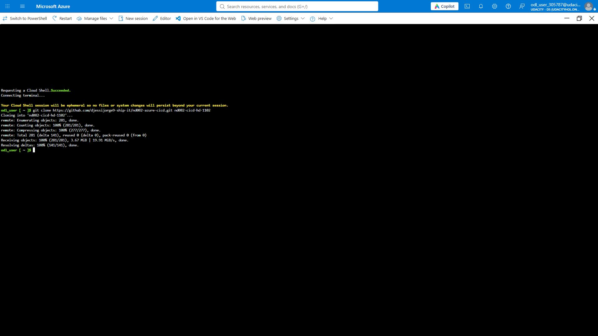

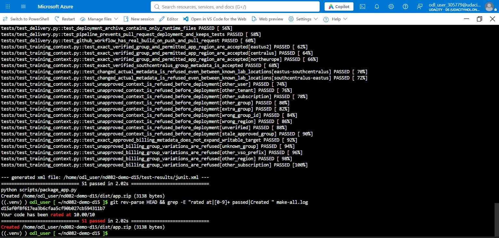

GitHub Actions:

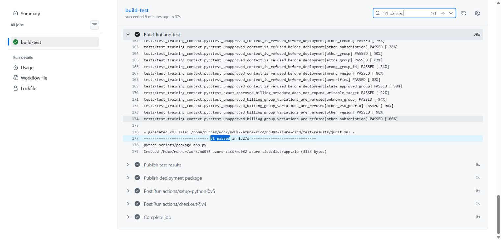

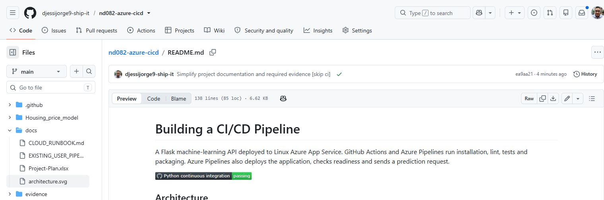

Azure Pipelines and App Service:

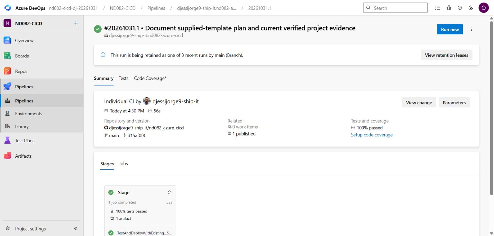

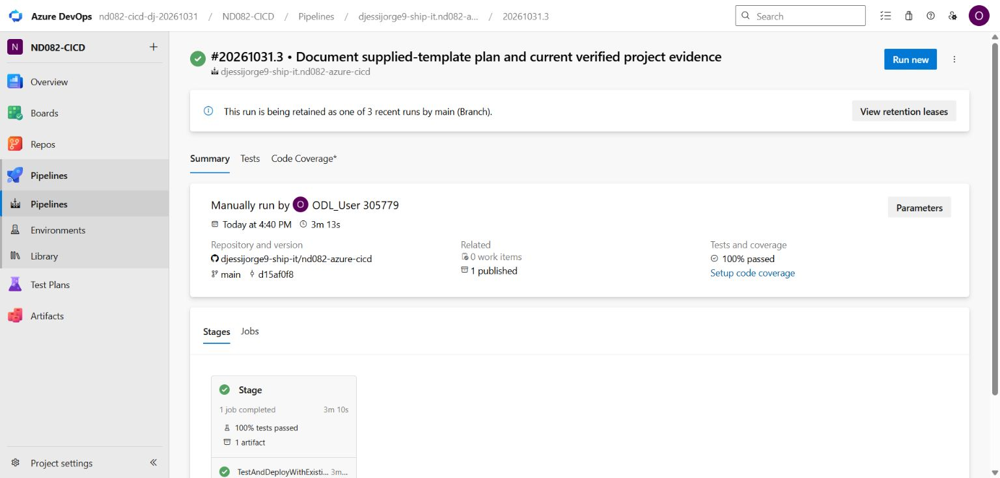

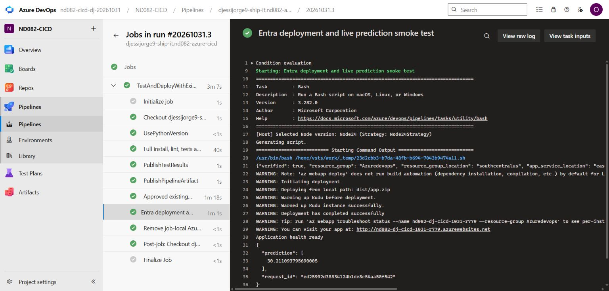

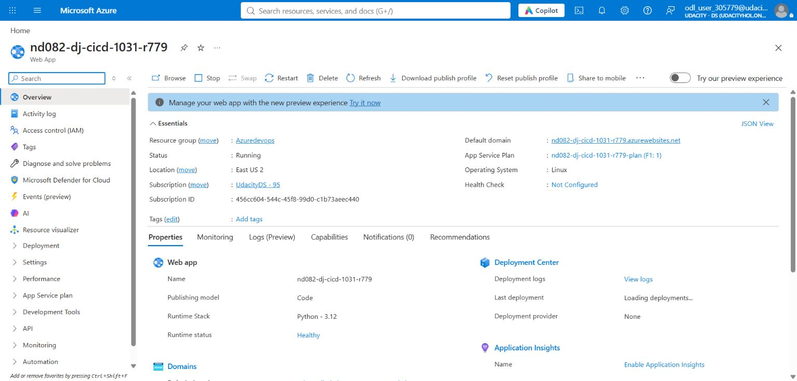

Prediction and streamed application logs:

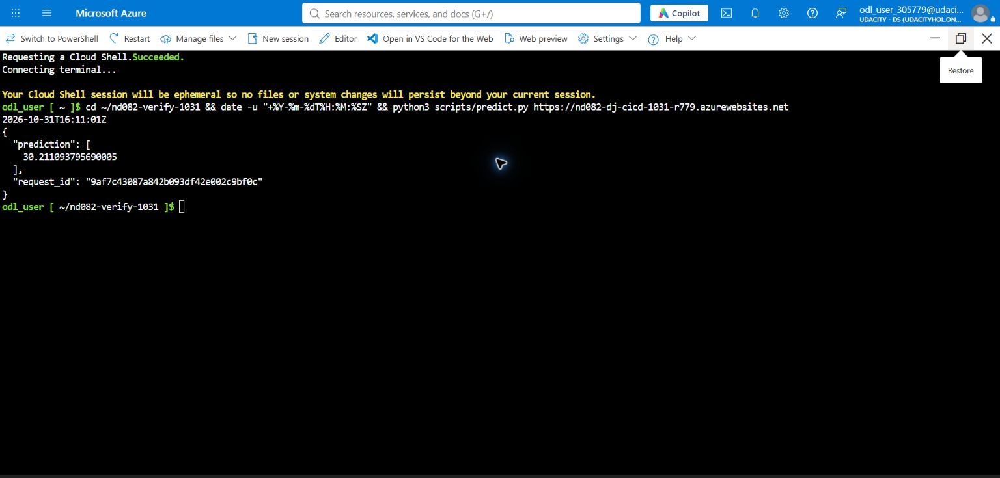

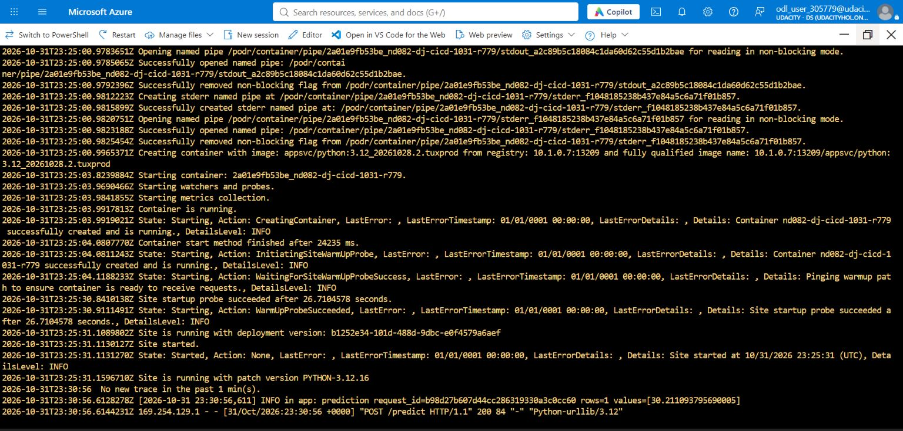

## Demonstration

[Workflow demonstration](https://youtu.be/R7jOR_7KNkQ)

## Model and API

The model takes `CHAS, RM, TAX, PTRATIO, B, LSTAT` in that order and uses raw feature values. `scripts/train_model.py` reproduces the supplied notebook with scikit-learn 1.5.1 and seed 7. The split contains 404 training and 102 test rows; held-out MSE is `39.95883743552935`. Model versions, features and hashes are in `Housing_price_model/metadata.json`.

`GET /health` reports model readiness. `POST /predict` returns predictions and a request ID. The API validates feature names, JSON structure, finite numeric values, batch sizes up to 100 and requests up to 16 KiB.

The supplied Boston housing dataset is used for this educational deployment example.

## Improvements

Future improvements include a suitable replacement dataset, versioned preprocessing, dependency updates, staging/rollback and availability/latency monitoring.

## Sources

- [Official Udacity starter](https://github.com/udacity/nd082-Azure-Cloud-DevOps-Starter-Code), commit `a239a572c6d6153317f29841973b49a9f78a84f9`, `C2-AgileDevelopmentwithAzure/project/starter_files/flask-sklearn`. The [starter license](LICENSE.udacity.md) is included.
- [Azure Pipelines Python App Service tutorial](https://learn.microsoft.com/en-us/azure/devops/pipelines/ecosystems/python-webapp?view=azure-devops).
- [Azure App Service Python guide](https://learn.microsoft.com/en-us/azure/app-service/quickstart-python).
