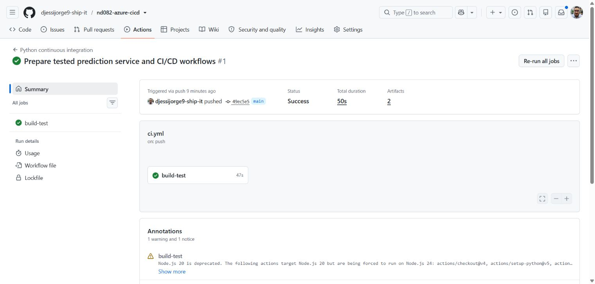
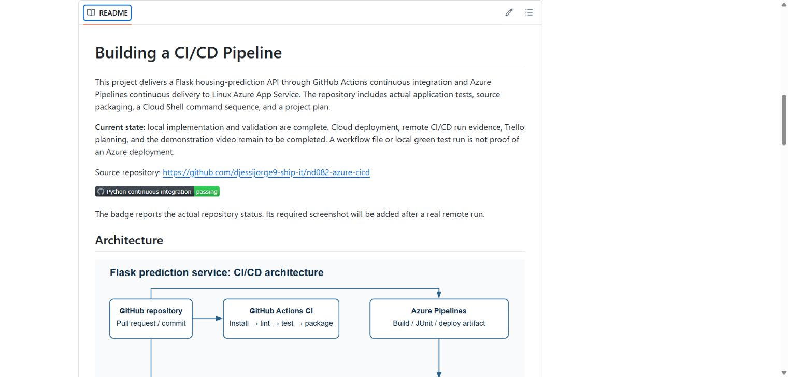
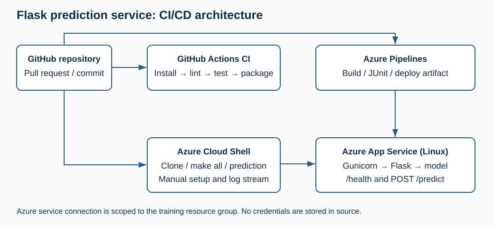
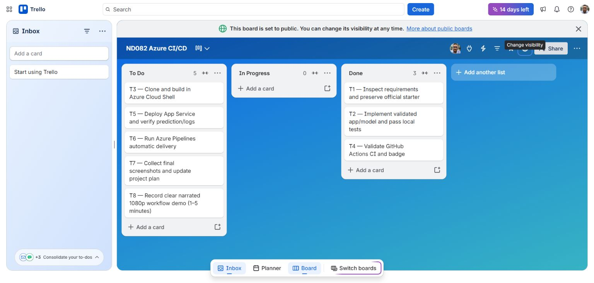

# Building a CI/CD Pipeline

This project delivers a tested Flask housing-prediction API to Linux Azure App Service. GitHub Actions supplies automatic CI. Azure Pipelines performs the complete build, test publication, packaging, Entra deployment and live prediction check after an attended training-user login.

**Verified on 25 October 2026:** 48 tests and pylint 10/10 in Azure Cloud Shell; successful GitHub Actions CI; a free F1 App Service with genuine prediction/log evidence; and [Azure Pipelines run 3](https://dev.azure.com/nd082-dj-20261025/ND082-CICD/_build/results?buildId=3), including 48 published passing cases and the `app-source` artifact. Final screenshot assembly and the required narrated video remain in progress.

Source: https://github.com/djessijorge9-ship-it/nd082-azure-cicd

[](https://github.com/djessijorge9-ship-it/nd082-azure-cicd/actions/workflows/ci.yml)

The badge reports the current repository status. [GitHub Actions run 40189164258](https://github.com/djessijorge9-ship-it/nd082-azure-cicd/actions/runs/40189164258) succeeded for source `3fc837af903e12ce98f527539a11848cfe37ae1a`, including 48 tests, lint and the runtime archive. The earlier screenshots below document the first successful 31-test build; the test suite was subsequently expanded to 48 cases.





## Architecture and actual delivery path



Commits and pull requests run GitHub lint, tests and packaging. A reviewed public snapshot is mirrored explicitly into private Azure Repos; this is not an automatic GitHub synchronization webhook. The verified Azure path uses `azure-pipelines-existing-user.yml`, Microsoft-hosted Ubuntu 24.04, and a manually queued run with `allowDeviceCodeBootstrap=true`. An operator authenticates the existing provided lab user through Microsoft's device-login page. An exact private scope guard then checks the user hash, tenant, subscription, writable group and approved target before any deployment.

The same job runs `make all`, publishes JUnit results and the tested archive, deploys with Microsoft Entra authentication, checks a live prediction, and removes its job-local login cache/private context. SCM and FTP basic publishing authentication remain disabled. No service principal, PAT, service connection or extra agent VM is used.

This is **attended delivery**, with manual authentication for each fresh worker. Source branch triggers exist, but their default opt-in is false; they do not establish unattended deployment. The retained `azure-pipelines.yml` service-connection alternative is unconfigured and its definition 1 is disabled. A separate [hosted-capacity probe, run 2](https://dev.azure.com/nd082-dj-20261025/ND082-CICD/_build/results?buildId=2), proves CI capacity only. Neither is substituted for the full run 3 delivery evidence. See [private-input and authentication details](docs/EXISTING_USER_PIPELINE.md).

Run 3 used Azure Repos commit `17bdad0f615507a8d0e68e1585df042dd7918ba9`, corresponding to public source `3fc837af903e12ce98f527539a11848cfe37ae1a`. All job tasks succeeded. The [Test Run 3 results](https://dev.azure.com/nd082-dj-20261025/ND082-CICD/_TestManagement/Runs?runId=3&_a=runCharts) and individual-case API readback confirm 48/48 Passed and one `app-source` PipelineArtifact. The Build Summary UI displayed “Get started/0 published”; the [actual test/artifact readback](evidence/azure-pipelines-run3-summary.json) records that presentation discrepancy.

## Project plan

The [Excel project plan](https://github.com/djessijorge9-ship-it/nd082-azure-cicd/blob/main/docs/Project-Plan.xlsx) contains the original/revised weekly task estimates, task states, and annual/quarterly milestones. A [local copy](docs/Project-Plan.xlsx) and [CSV companion](docs/PROJECT_PLAN.csv) are included. Original and revised estimates total 6 and 7 hours; these are planning assumptions, not recorded labour times. Some planned later-week tasks were completed early on 25 October.

The [publicly readable Trello board](https://trello.com/b/9wbc68TD/nd082-azure-ci-cd) has To Do, In Progress and Done lists. T1–T6 are Done: requirements, application/model tests, Cloud Shell, GitHub CI, App Service and attended Azure delivery. T7 final evidence and T8 demonstration/handoff remain open. Only board members can edit. The older board screenshot below records the earlier CI checkpoint.



## Run locally

Use Python 3.12 in a virtual environment. From the repository root on Bash:

```bash
python3 -m venv .venv
source .venv/bin/activate
make all
make test
make run
```

On Windows activate `.venv\Scripts\Activate.ps1`. Without Make, run `python -m pip install -r requirements-dev.txt`, `python -m pylint app.py scripts tests`, `python -m pytest -v`, and `python scripts/package_app.py`. In another terminal, run `python scripts/predict.py http://127.0.0.1:5000`.

The sample predicts approximately `30.211093795690005`. Responses contain request IDs. `GET /health` checks model readiness. The API rejects missing/extra features, invalid JSON, non-finite values, mismatched batches, requests over 16 KiB and batches over 100 rows. Prediction logs contain values and request IDs without all input features.

### Model contract

The model uses `CHAS, RM, TAX, PTRATIO, B, LSTAT` in that order. The starter selected a linear model trained on raw features, so this service does not fit a scaler on inference data. The original per-request scaler reduced single rows to zero vectors and made predictions constant; this correction changes the obsolete starter example output.

The original serialized model used scikit-learn 1.1.3 while the current starter pins 1.5.1. `scripts/train_model.py` reproduces the official notebook with the included CSV, six features, seed 7, and scikit-learn 1.5.1. The split is 404 training/102 test rows; actual held-out MSE is `39.95883743552935`. Versions, feature order, coefficients and data/model hashes are in `Housing_price_model/metadata.json`. This demonstrates reproducibility, not production model quality.

The historical Boston dataset contains a racially constructed feature. It is retained only to reproduce this supplied educational exercise and is unsuitable for real housing decisions. A new application should use an appropriate dataset and versioned preprocessing.

## Cloud Shell and application evidence

Actual Cloud Shell clones of the public source completed `make all` with 48 passing tests, pylint 10/10, a 3,138-byte runtime archive and exit 0. The first retained build used `bf886ac3b409a93a4ad442b7688dcb5eb22385ac`; the final capture repeated it at the hosted-delivery source snapshot. Cloud Shell also returned the deployed sample prediction. These were ephemeral Bash sessions without a storage account. Screenshots and a visible console excerpt are retained; the normal full-log download failed and is not presented as available.

The [training App Service](https://nd082-dj-cicd-20261025-ac51b6.azurewebsites.net) passed real health, single-row, batch and invalid-schema HTTP checks. Its first-row prediction remains unchanged in a batch, while increasing RM changes the second result. See [actual HTTP responses](evidence/azure-prediction.json) and [matching Azure request-ID log lines](evidence/azure-prediction-log.txt). This temporary training app may be removed after evidence collection.

The [cloud runbook](docs/CLOUD_RUNBOOK.md) records reproducible steps. `commands.sh` includes the required `az webapp up -n "$APP_NAME"` operation with basic publishing auth disabled. The writable group is exactly `Azuredevops`, metadata region `eastus`; the separately approved App Service target is `eastus2`. An exact service-managed DevOps billing group is read-only baseline metadata, never a deployment or cleanup target. Keep private scope files and tokens outside source/evidence archives.

## Validation and remaining evidence

| Evidence | Observed result |
| --- | --- |
| Cloud Shell clone, build and tests | Actual 48 tests, lint 10/10, package and exit 0; screenshot/visible excerpt retained |
| GitHub Actions and badge | Actual successful run 40189164258 for source 3fc837; earlier screenshots included |
| App Service and predictions | F1 Linux deployment; genuine HTTP and runtime log records included |
| Azure Pipelines full delivery | Run 3 succeeded; exact-scope authentication, 48 tests, JUnit, artifact, Entra deployment, smoke check and token-cache removal |
| Published cases and artifact | Test Run 3/build 3: 48 cases, all Passed; one app-source PipelineArtifact, verified through official APIs |
| Trello and estimates | T1–T6 Done; workbook/CSV updated; final evidence/handoff tasks open |
| Clear narrated 1080p video, 1–5 minutes | Recording and final publication in progress |

`evidence/status.json` records the current evidence scope. No local test is relabeled as a remote build, and a prepared YAML file alone is not treated as executed delivery. The 48 local cases include seventeen training-context guard cases; the current lint score is 10/10.

## Demonstration and enhancements

YouTube demonstration link: pending final capture and publication. It must show Cloud Shell, GitHub Actions, actual Azure Pipelines deployment and deployed JSON prediction with readable text and clear narration.

Future proposals are a suitable replacement dataset, drift/model-version checks, reviewed dependency updates, approved staging/rollback, and availability/latency monitoring. The 2027 roadmap is a proposal, not authorization for ongoing Azure spend.

## Sources

- [Official Udacity starter](https://github.com/udacity/nd082-Azure-Cloud-DevOps-Starter-Code), commit `a239a572c6d6153317f29841973b49a9f78a84f9`, directory `C2-AgileDevelopmentwithAzure/project/starter_files/flask-sklearn`. Original source is preserved separately; its license is included as `LICENSE.udacity.md`.
- [Azure Pipelines Python App Service tutorial](https://learn.microsoft.com/en-us/azure/devops/pipelines/ecosystems/python-webapp?view=azure-devops) and [Azure App Service Python guide](https://learn.microsoft.com/en-us/azure/app-service/quickstart-python), checked 25 October 2026.
- Current classroom rubric: ND082 version 3.0.16, Building a CI/CD Pipeline, checked 25 October 2026.
